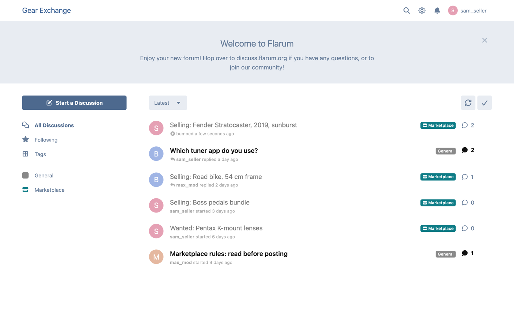
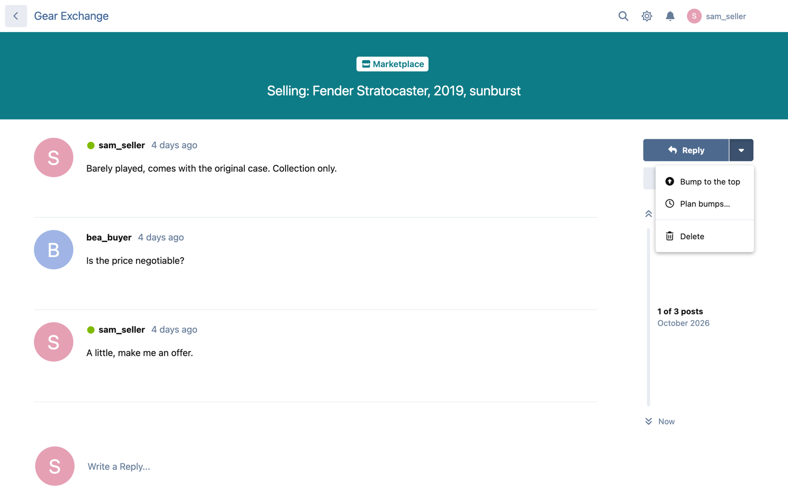
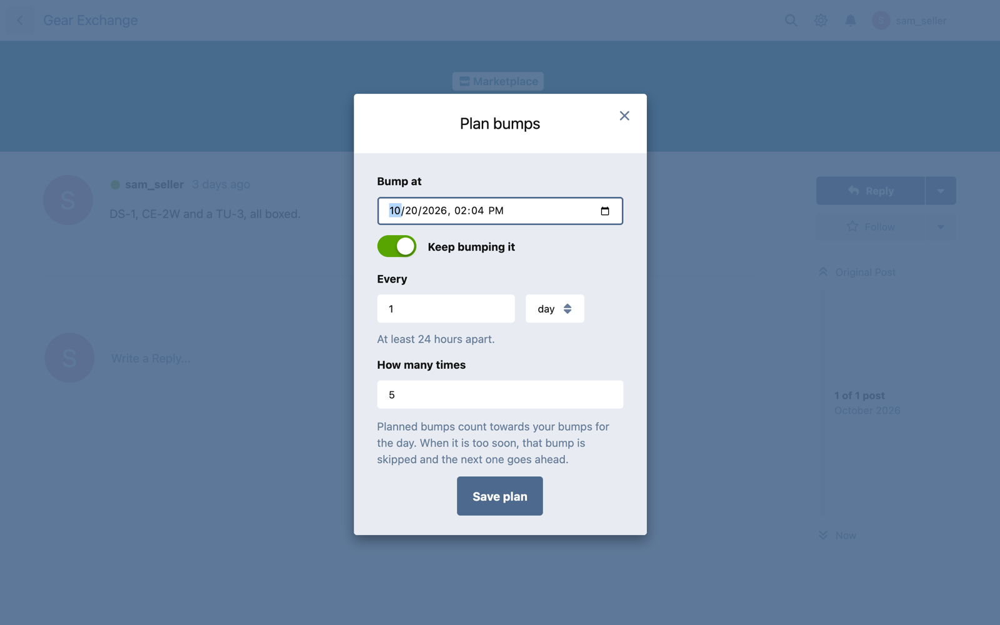
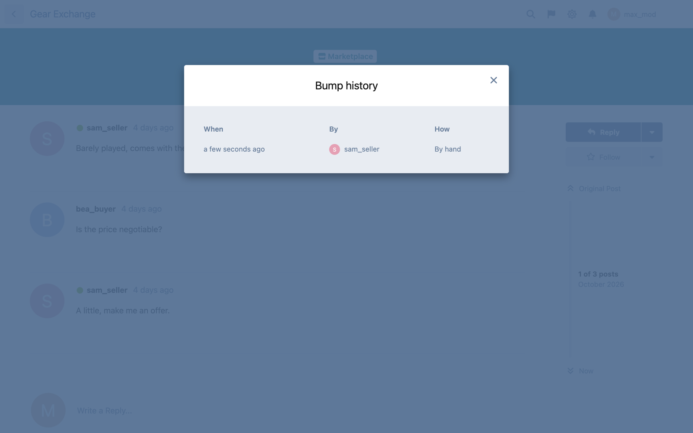
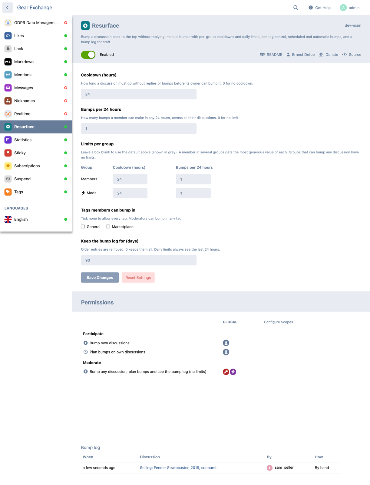
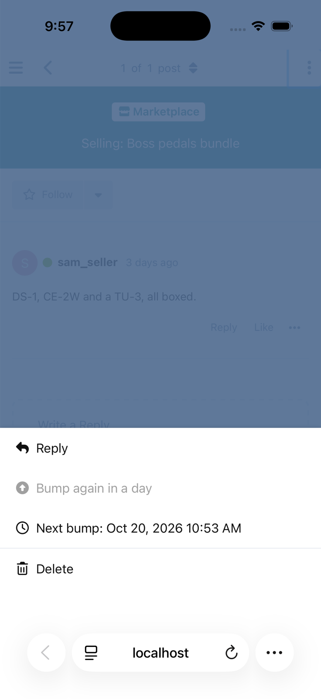

# Resurface

 [](https://packagist.org/packages/ernestdefoe/resurface) [](https://packagist.org/packages/ernestdefoe/resurface)

A [Flarum](https://flarum.org) 2 extension. Members bump a discussion back to the top of the list **without replying**. It suits marketplaces, classifieds, trade and wanted boards, and anywhere else a "bump" post is just noise.

- **Bump to the top**, from the discussion's menu. No post is made and nobody is notified.
- **Limits**: a cooldown since the discussion's last activity, and a number of bumps per 24 hours. Both have defaults, and you can override them per group.
- **Tags**: choose the tags members can bump in. With Tags installed, restricted tags also take the permissions per tag.
- **Planned bumps**: bump once at a set time, or every so many hours or days, a number of times or until cancelled.
- **Bump log for staff**: every bump, who made it and how (by hand, planned, repeating). It's in the admin page and in each discussion's menu.
- **Lists say "bumped 5 minutes ago"** rather than claiming someone replied.

## Screenshots

| The list after a bump | The discussion menu |
| --- | --- |
|  |  |
| **Planning bumps** | **Bump history (staff)** |
|  |  |



On phones the bump and plan items sit in the discussion's menu sheet:



## Installation

```sh
composer require ernestdefoe/resurface
```

Enable **Resurface** in the admin panel. Planned and repeating bumps need Flarum's scheduler, the cron line from [the Flarum docs](https://docs.flarum.org/2.x/console#schedulerun):

```
* * * * * cd /path/to/flarum && php flarum schedule:run >> /dev/null 2>&1
```

Resurface runs every minute and only reads the plans that are due (an indexed query). Each run handles at most 100 plans, so a backlog drains over a few minutes instead of in one long burst.

## Updating

```sh
composer update ernestdefoe/resurface
php flarum migrate
php flarum cache:clear
```

## Permissions

| Permission | Default | What it allows |
| --- | --- | --- |
| Bump own discussions | Members | Bump your own discussions, within the limits |
| Plan bumps on own discussions | nobody | Planned and repeating bumps on your own discussions, within the same limits |
| Bump any discussion, plan bumps and see the bump log | Mods | Bump any discussion with no limits, plan bumps on any discussion, read the log |

Owners can't bump a discussion that is locked or waiting for approval. Nobody can bump a hidden one.

**Restricted tags** (with Tags) take the permissions per tag, as Flarum does everywhere else. A group needs the tag's own "Bump own discussions" (and "Plan bumps") to bump its discussions there. Staff need the tag's "Bump any discussion". The bump log covers the whole forum, so it needs the global "Bump any discussion" permission.

## Limits

- **Cooldown (hours)** counts from the discussion's **last activity**: its last reply or its last bump. Bumping a discussion that is already near the top does nothing, so it's always the time since activity that counts. Default: 24.
- **Bumps per 24 hours** counts every bump the member made in the last 24 hours, across all their discussions, planned ones included. Default: 1.
- **Per group**: a group with an override replaces the default. A member in several such groups gets the most generous value of each, so an override can be stricter (new members) or looser (sellers, VIPs). `0` means no cooldown or no limit.

## Planned and repeating bumps

A plan runs as the member who saved it, with that member's permissions and limits **at the time each bump is due**.

- If it's too soon or the member has used their bumps, that run is skipped. A repeating plan tries again a full interval later. A one-off plan ends.
- If the member can no longer bump or plan bumps on the discussion (it was locked, hidden or made private, they lost a permission or were suspended, or the tag is no longer allowed), the plan ends.
- A repeating plan with a count ends after that many bumps actually made. Skipped runs don't count.
- The discussion's owner can cancel or replace a plan a moderator made on it.
- Repeats can't be closer together than the member's cooldown. Staff have no such limit.
- Missed runs (the scheduler was down) are not made up in a burst. The next bump comes one interval after the scheduler is back.
- When a moderator saves a plan on someone else's discussion, the plan becomes the moderator's.

## What a bump changes, and what it doesn't

A bump moves the discussion's `last_posted_at`, which is what Flarum's "Latest" list sorts by, and records `resurface_bumped_at`. That keeps the sort on Flarum's own index: it adds no query and no join to the discussion list, and Sticky, FrontPage and every other extension that orders by `last_posted_at` keeps working. Everything else stays as it was:

| | Behaviour | Why |
| --- | --- | --- |
| **Unread** | Members who have read the discussion don't see it as unread. A member who never opened it and has used "Mark all as read" since its last reply will see it as unread again. | Post numbers don't change, and those are what Flarum's unread count is built from. The second case is the bump doing its job: someone who has never seen a listing should notice it. |
| **"Replied" in lists** | Shows "bumped 5 minutes ago". After the next real reply it shows "replied" again. | A bump isn't a reply, and naming the last poster against the bump time would be wrong. |
| **Notifications, emails, followers** | Nothing is sent. | No post is created. |
| **Hiding or deleting a later post** | The discussion keeps its bump position. | Flarum recomputes the last post time when a post is hidden. Resurface keeps the bump unless a newer reply passes it. |
| **Tags page** | The bumped discussion becomes the tag's latest discussion, exactly as a reply would make it. | It's now the latest discussion in that tag by the same measure the list uses. |
| **FoF Prevent Necrobumping** | A bump counts as activity: a reply soon after a bump doesn't warn about an old discussion. | Bumping says "this is still current", and by then the discussion is at the top of the list. Leave the tags where necrobumping matters off Resurface's tag list. |
| **FoF Sitemap** | The discussion's `lastmod` moves to the bump time. | The sitemap reads the same column. A listing its owner has just confirmed as current is reasonably "modified". Resurface doesn't replace FoF Sitemap's resource, so it can't break a sitemap. |
| **Digest emails** | Digests that pick "active discussions" by last activity can include a bumped one. | They read the same column. |

## Charging for bumps

Resurface never takes payments. For paid bumps, [Payments by Floxum](https://floxum.com) has **Pay to Bump**. Developers can hook into the `Ernestdefoe\Resurface\Event\Bumping` event, which fires once every check has passed and before the bump is made. Throwing an exception there (for example a `Flarum\Foundation\ValidationException` with a message for the member) stops the bump. `Ernestdefoe\Resurface\Event\Bumped` fires afterwards. Points, credits or a payment check can live in your own extension.

## API

- `PATCH /api/discussions/{id}` with `{"resurfaceBump": true}` bumps the discussion.
- `PATCH /api/discussions/{id}` with `{"resurfaceSchedule": {"at": "<ISO 8601>", "every": <hours or null>, "times": <count or null>}}` saves a plan. `null` cancels it.
- `GET /api/resurface-bumps?filter[discussion]={id}` returns the log, for staff.
- Discussion attributes: `resurfaceBumpedAt` everywhere. On a single discussion only: `resurfaceCanBump`, `resurfaceNextBumpAt`, `resurfaceBumpsLeft`, `resurfaceCooldown`, `resurfaceCanSchedule`, `resurfaceCanViewLog` and `resurfaceSchedule`.

## Translations

English and French are included. Every string is in `locale/`.

## Links

- [Source](https://github.com/ernestdefoe/resurface)
- [Report an issue](https://github.com/ernestdefoe/resurface/issues)
- ☕ [Buy me a coffee](https://buymeacoffee.com/ernestdefoe)
